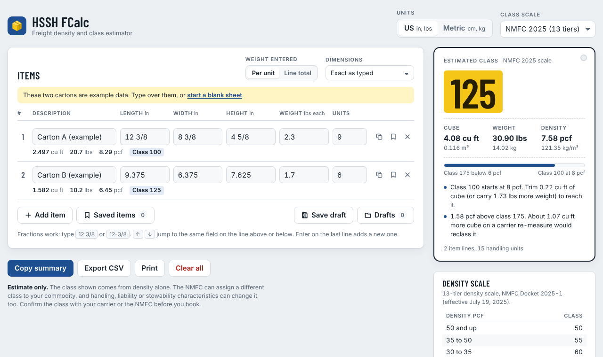

# HSSH FCalc

A freight density and class calculator for LTL shipments. Enter each item's
dimensions, weight and unit count, and FCalc gives you the shipment's total cube,
weight, density (pounds per cubic foot) and the estimated NMFC freight class.

It runs in any modern browser with no install and no internet connection, and
the same files become a website (GitHub Pages) and a desktop app for macOS and
Windows.



## Use it right now

1. Download or clone this repository.
2. Double-click `index.html`. It opens in your browser and works offline.

Everything you type is saved in that browser automatically, so the sheet is
still there the next time you open it.

## What it does

**Core calculation**
- Cube, weight, density and class for the whole shipment, updated as you type
- US (inches, pounds) or Metric (centimeters, kilograms), with every result shown in both
- NMFC density scale table with your class highlighted

**Add-ons**
- **Unlimited item lines** with an optional description. Add, duplicate or remove lines.
- **Fractions**: type `12 3/8` or `12-3/8` instead of converting to decimals.
- **Per-line results**: each line shows its own cube, weight, density and class, so you can spot the item that drags the shipment into a higher class.
- **Weight per unit or line total**: switch depending on how your packing list gives weights.
- **Carrier dimension rounding**: exact, nearest whole inch, or round up to the next whole inch, to see what a carrier re-measure would bill.
- **Class scale choice**: the current NMFC 2025 13-tier scale (default) or the legacy 18-class scale some contracts still reference.
- **Next-class guidance**: how much cube to trim to reach the next cheaper class, and how close you are to slipping into the next pricier one.
- **Unit switching converts your entries**: switching to Metric converts every line, and switching back restores exactly what you typed.
- **Saved items**: save a carton or pallet you ship often and add it again in one click.
- **Drafts**: save the whole sheet under a name (description, length, width, height and weight of every item) and open it again later. Units are not saved, so you enter fresh quantities for each shipment.
- **Spreadsheet-style keys**: the Up and Down arrows jump to the same field on the line above or below; Enter on the last line adds a new one.
- **Copy summary** for emails and quote requests, **Export CSV** for spreadsheets, and a clean **Print** layout.
- **Undo** after removing a line or clearing the sheet.
- Light and dark mode, and a layout that works on phones.

## Density scale used

FCalc defaults to the 13-tier density scale that NMFTA introduced in NMFC
Docket 2025-1, effective July 19, 2025:

| Density (lb/ft³) | Class |
| --- | --- |
| 50 and up | 50 |
| 35 to under 50 | 55 |
| 30 to under 35 | 60 |
| 22.5 to under 30 | 65 |
| 15 to under 22.5 | 70 |
| 12 to under 15 | 85 |
| 10 to under 12 | 92.5 |
| 8 to under 10 | 100 |
| 6 to under 8 | 125 |
| 4 to under 6 | 175 |
| 2 to under 4 | 250 |
| 1 to under 2 | 300 |
| Under 1 | 400 |

> **Estimate only.** The class comes from density alone. The NMFC can assign a
> specific class to your commodity, and handling, liability or stowability can
> change it. Confirm with your carrier or the NMFC before you book.

## Publish it

- **As a website on GitHub Pages:** see [docs/PUBLISH-ON-GITHUB.md](docs/PUBLISH-ON-GITHUB.md)
- **As a macOS and Windows app:** see [docs/DESKTOP-APP.md](docs/DESKTOP-APP.md)

## Project layout

| Path | What it is |
| --- | --- |
| `index.html` | The page |
| `css/styles.css` | All styling, including dark mode and print |
| `js/calc.js` | The math: unit conversion, density, class lookup, CSV and summary text. No page code, so it is easy to test. |
| `js/app.js` | The interface: reads inputs, shows results, saves your sheet |
| `assets/` | App icons and the bundled Barlow Condensed font (SIL Open Font License) |
| `manifest.webmanifest`, `sw.js` | Let the website install as an app and work offline |
| `electron/main.js` | The desktop app window (macOS and Windows) |
| `build/icon.png` | Desktop app icon |
| `tests/calc.test.js` | Automated checks for the math |
| `.github/workflows/` | Automation: tests, website deploy, desktop builds |

## For developers

Requires [Node.js](https://nodejs.org) 22 or newer for the tests and the desktop app.
The browser version needs nothing.

```bash
npm test            # run the calculation tests
npm install         # one time, downloads Electron for the desktop app
npm start           # open the desktop app from source
npm run dist:mac    # build the .dmg (run on a Mac)
npm run dist:win    # build the .exe installer (run on Windows)
```
